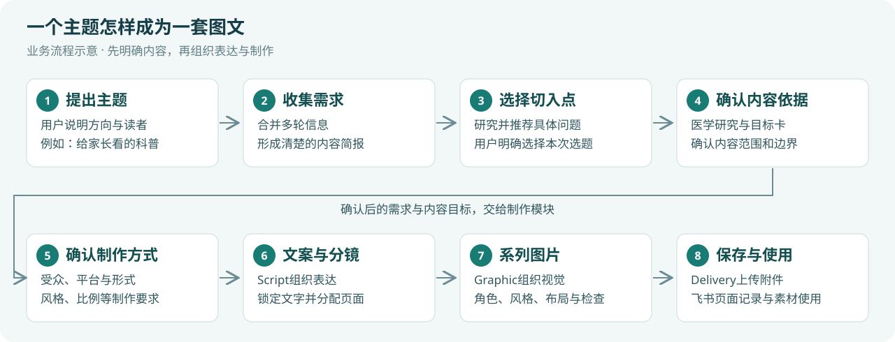
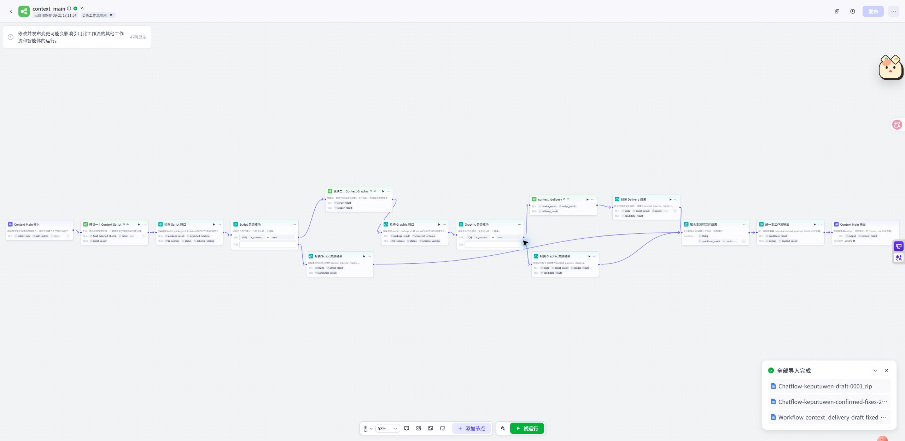

# 医疗科普图文系统

这是一套在Coze中实现的内容生产系统。用户用自然语言提出一个健康科普主题，系统通过多轮沟通明确需求，研究读者关心的问题与医学依据，再把确认后的内容转化为文案、分镜和系列图片，并通过飞书管理素材与页面结果。

它适合需要持续制作科普内容的团队：同一套流程可以围绕不同健康主题组织内容，也可以为家长、儿童、亲子设置不同的表达方式。

## 快速使用

这是系统设计、SOP、工作流截图与图文样例的脱敏文档仓库。实际内容生产在使用者自己的Coze空间运行；当前仓库未附可直接导入的工作流导出包。

1. 直接阅读下面的README与章节，或从GitHub的Code菜单下载ZIP。
2. 解压后双击`docs/展示.html`，离线查看完整图文说明。
3. 需要连接自己的Coze与飞书时，按[使用说明](docs/使用说明.md)准备工作流、数据表和配置。

也可以克隆到本地：

```bash
git clone https://github.com/luziyangz/coze-medical-infographic-system.git
cd coze-medical-infographic-system
```

修改Markdown后重新生成展示页：

```powershell
python -m venv .venv
.\.venv\Scripts\python.exe -m pip install -r requirements.txt
.\.venv\Scripts\python.exe tools/render_docs.py
.\.venv\Scripts\python.exe tools/check_release.py
```

完整步骤见[使用说明](docs/使用说明.md)，个人配置的保存方式见[配置说明](config/README.md)。

## 阅读入口

| 想了解什么 | 从这里阅读 |
|---|---|
| 完整图文介绍 | [打开展示文档](docs/展示.html) |
| 一个主题怎样变成一套图文 | [整体流程与操作SOP](docs/01-操作SOP.md) |
| 每个工作流的用途、输入输出与组合关系 | [工作流职责与组合](docs/02-工作流职责与组合.md) |
| 怎样生成不同风格，与飞书怎样协作 | [图文生成与飞书协作](docs/03-图文生成与飞书协作.md) |
| 最后能得到什么样的图文 | [图文效果与应用案例](docs/04-图文效果与应用案例.md) |
| 怎样单独调用模块、迁移到其他业务 | [模块复用与拓展](docs/05-模块复用与拓展.md) |

## 系统的整体逻辑



例如，用户提出“做一组面向家长的儿童鼻炎科普”。系统先了解读者、内容范围和制作偏好，再围绕这个方向整理候选问题。用户选择切入点后，系统研究相关医学证据，确认内容目标与边界，随后进入文案、分镜、生图和保存。

主题、具体选题和表现方式分别管理。因此，“换一个鼻炎选题”“改成亲子版”“换成水彩风格”和“重新做儿童睡眠主题”，可以得到不同的处理。

## 八个工作流怎样协作

| 工作流 | 解决的问题 | 交给下一步的结果 |
|---|---|---|
| 科普主对话 | 用户现在想做什么，任务到了哪一步，哪些内容已经确认 | 当前任务、用户反馈及下一步调用 |
| 意图收集 | 把聊天中的想法整理成可执行的内容需求 | 结构化需求与补充问题 |
| 痛点分析 | 在大主题里找到值得讲清楚的具体问题 | 候选选题与选题说明 |
| 医学研究 | 明确本次科普的知识依据、内容目标和表达边界 | 医学目标卡与来源 |
| 图文创作主线 | 将文案、生图、交付连接成一次内容制作 | 汇总后的图文结果 |
| Script | 决定讲什么、怎样讲、每页讲多少 | 标题、正文与逐页分镜 |
| Graphic | 把分镜转成有角色、风格和版式的系列图片 | 页面候选图及检查结果 |
| Delivery | 把生成结果整理成团队可管理的内容记录 | 飞书图片附件与页面记录 |

## 图文生成与飞书

Script负责文案和分镜，Graphic负责视觉资产、页面设计与图片，Delivery负责整理和保存。

飞书贯穿这条链路：Script读取平台表达规则，Graphic读取角色、风格和布局资产，Delivery把生成后的图片上传为附件，再将页面文字、图片和相关信息写入多维表格。素材配置和内容结果因此可以在同一个协作平台中管理。

<p></p>

## 能产出什么

- 围绕某个主题形成明确的读者需求、候选选题与内容目标。
- 为家长、儿童或亲子组织不同的文案和页面分镜。
- 依据选定风格、角色参考和布局要求生成多页科普图片。
- 将页面文字、图片和结果信息组织为飞书内容记录。

下列为系统一次六页生成中的候选样张，用于展示页面形态；完整六页见[图文效果](docs/04-图文效果与应用案例.md)。

| 封面 | 读者困惑 | 知识解释 |
|---|---|---|
|  |  |  |

## 哪些设计可以复用

意图收集可迁移到课程策划、客户需求沟通和内容简报；“检索—聚类—推荐”的选题模块可以用于教程或知识内容策划；“文案—分镜—视觉—归档”的生产链可以用于产品使用指南、企业培训图卡等。

迁移时保留模块分工和交接方式，为新领域配置需求字段、资料来源、内容规则和视觉资产。具体的独立调用方式与迁移示例见[模块复用与拓展](docs/05-模块复用与拓展.md)。

## 文件说明

完整Markdown、离线HTML、工作流概览和候选样图位于[文档目录](docs/README.md)。截图用于展示模块结构，点击原图可放大；业务流程图为单独绘制的逻辑示意。
