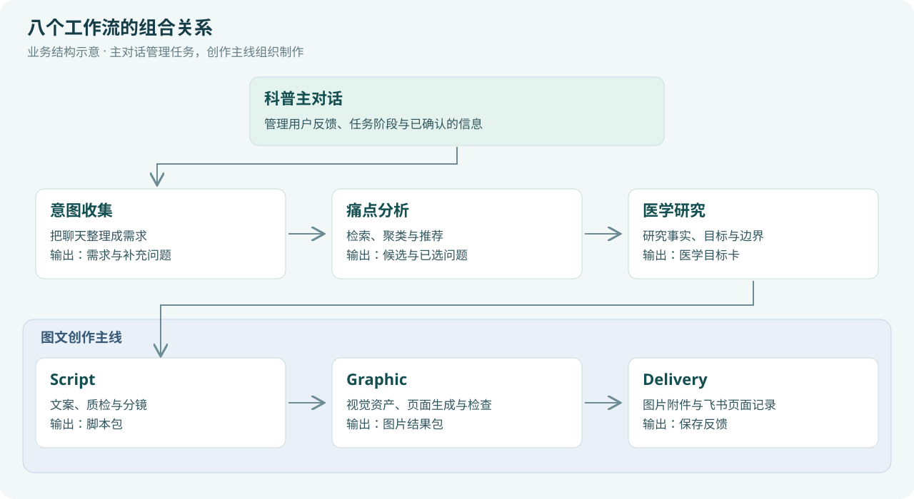
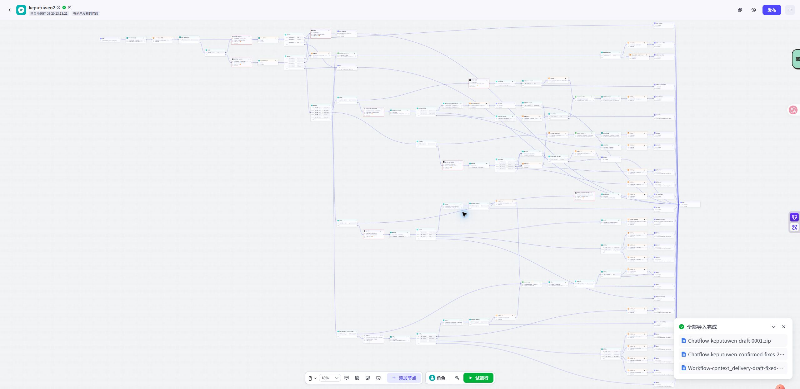
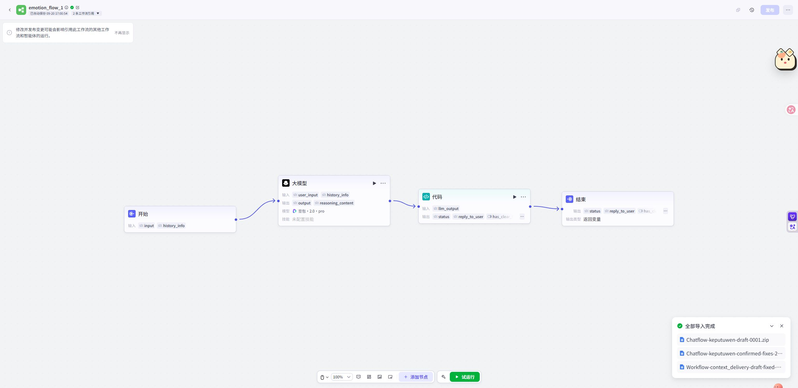
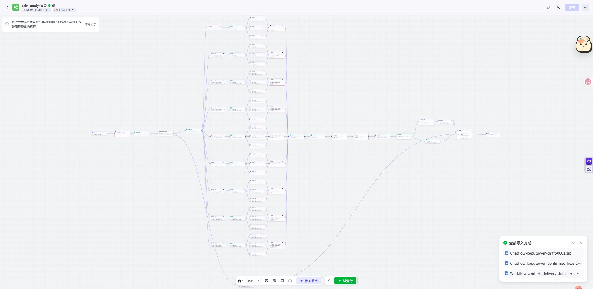
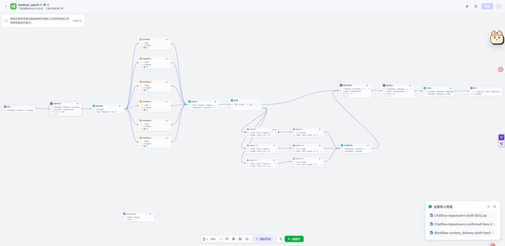
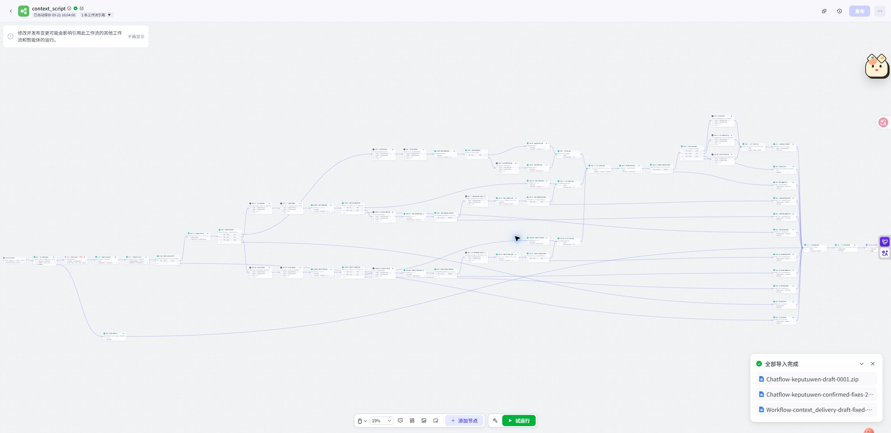
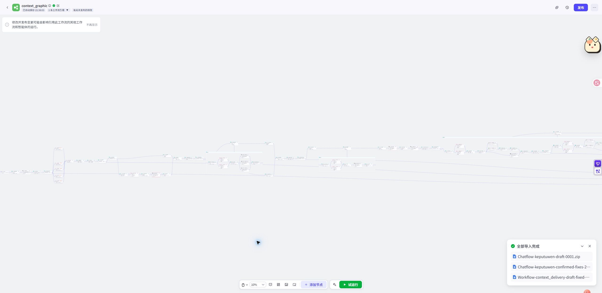
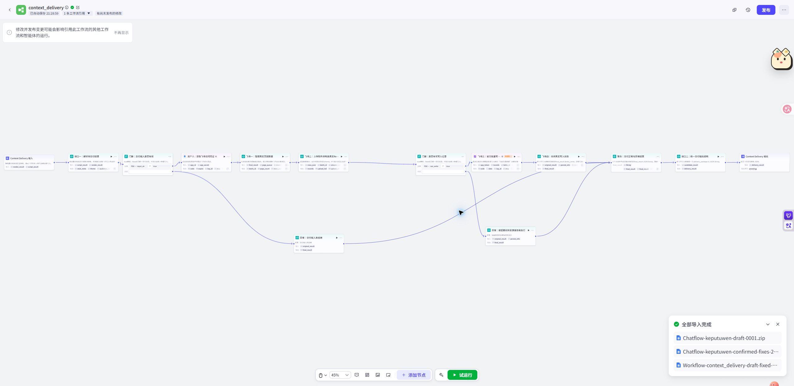

# 八个工作流各自负责什么

系统把任务拆分，让每个模块处理明确的问题，并把整理好的结果交给下一步。理解交接关系后，就能知道哪些模块需要一起使用，哪些可以独立调用。

这里有两种“意图”处理：**主对话识别用户本轮正在做什么，意图收集整理用户想制作什么内容。** 前者决定走哪条流程，后者形成制作所需的需求。

## 1. 科普主对话：理解本轮动作，安排下一步

**作用：** 管理整项任务与用户的多轮沟通。它结合当前阶段和已保存的信息，区分用户是在补需求、问候选、选题、确认医学目标、改参数，还是开始新主题。

它接收用户消息，读取已知需求、候选、目标卡和内容结果，再选择需要调用的子工作流。用户看到的是自然语言，后台保存的是后续可继续使用的任务信息。

例如，同样一句“继续”，在已说明医学限制后可能表示接受受限版，在参数草稿之后则需要结合明确的确认对象理解。主对话让用户反馈进入对应业务阶段。

**怎样组合：** 调用意图收集、痛点分析、医学研究和图文创作主线，根据返回结果更新任务状态，再把有用的内容呈现给用户。

## 2. 意图收集：把聊天整理成内容简报

**作用：** 将零散的自然语言逐步整理为完整需求。它同时读取本轮消息和历史需求，提取新信息、继承已知信息，并判断下一步还需要问什么。

例如，用户先说“做鼻炎科普”，再说“给6岁孩子的家长看”，系统应把两次回答合并：方向是鼻炎，读者是6岁孩子的家长。之后用户补充风格时，原来的方向与读者继续保留。

| 接收 | 处理 | 输出 |
|---|---|---|
| 新消息 + 历史需求 | 提取、合并、识别缺项、确认冲突 | 更新后的需求 + 是否完整 + 给用户的下一句回复 |

这份需求随后供痛点分析生成检索方向，也供Script和Graphic理解读者、平台、风格等要求。未收集完整时，主对话保存当前信息，再接收下一轮补充。

**可复用的想法：** 把“需要知道哪些信息”“哪些已确认”“还有什么要问”分开记录。这个结构也能用于课程简报、产品需求访谈和服务需求收集。

## 3. 痛点分析：把大方向变成可选的问题

**作用：** 帮用户找到内容的具体切入点。它从需求和新偏好生成关键词，进行九路搜索与网页提炼，再对问题去重、聚类、排序，整理成候选选题及说明。

面对“儿童鼻炎”，内容策划可以先比较不同困惑，再选择这次要讲清楚的问题。候选说明帮助用户理解选题的生活场景、认知与行为切入点。

它接收结构化需求和用户补充偏好，输出候选列表。用户明确选定其中一个后，主对话把单个已选对象交给医学研究。

**怎样组合：** 意图收集限定研究范围，痛点分析提出切入点，医学研究为选中的切入点寻找依据。候选来自资料整理，不等同于经过统计验证的关注度排行。

## 4. 医学研究：把选题转成有依据的内容目标

**作用：** 为内容创作准备事实、目标和边界。它根据已选痛点检索知识库，在需要时补充网页材料，再提取医学事实，形成医学目标卡。

这张卡把后续创作需要共同遵守的信息集中起来：本次重点解释什么、依据哪些材料、有哪些限制、哪些表达应避免。

| 输入 | 输出 | 下游用途 |
|---|---|---|
| 需求、单个已选痛点、研究调整要求 | 医学目标卡、来源及范围说明 | Script据此写文案，主对话据此向用户确认 |

用户确认后，医学目标与制作要求一起进入Script。医学研究负责知识依据，Script负责把它转成适合读者的表达。

## 5. 图文创作主线：组织一次完整制作

**作用：** 把已经确认的需求和内容目标，依次交给三个制作模块。

它接收本次选题、需求、已选痛点和医学目标卡，调用Script；获得脚本分镜后调用Graphic；拿到图片结果后调用Delivery。各模块结果最后统一汇总，交回主对话。

**组合的意义：** 内容准备与内容生产具有明确的交接点。上游负责“这次要做什么”，主线负责“按顺序完成制作”，三个子模块各自产出可继续使用的结果。

## 6. Script：把内容目标写成文案和分镜

**作用：** 决定信息怎样讲、怎样分配到页面。它读取平台规则，根据家长、儿童、亲子模式分别组织语言，完成文案生成与质检，再锁定文字并生成分镜。

家长表达侧重解释与可理解的内容组织；儿童表达需要适龄语言和场景；亲子表达则需要便于共同阅读或互动。相同选题因此可以形成不同的讲述方式。

它输出标题、正文与逐页分镜的脚本包。Graphic使用它安排画面，Delivery使用其中的文字和元信息整理页面记录。团队也可以独立使用Script获取文案与设计说明。

## 7. Graphic：把分镜变成系列视觉

**作用：** 组织整套图片的角色、风格、布局与生成。它先识别跨页人物和场景需求，再匹配资产、准备参考、规划整套页面，最后逐页生图与检查。

已有角色或风格可以直接进入匹配；需要新的持续角色或派生风格时，则先准备母版、检查并锁定，再提供给页面制作。反复同框的人物还可以通过组合锚点约束相互关系。

每页生成候选后，系统结合OCR文字检查与视觉检查整理结果，必要时定向重试，最终输出页面素材包。

**怎样组合：** Script提供内容与分镜，飞书提供资产候选，Graphic形成图片，Delivery接着归档。

## 8. Delivery：把内容变成可管理的页面记录

**作用：** 将生成结果按页整理，并保存到飞书。它同时读取Script与Graphic的结果，使文字、图片、版本、风格和页面信息能够对应起来。

图片先上传为飞书附件，再与页面字段一起写入多维表格。保存结果随后返回主线与主对话。

团队可以按批次、主题和页面查找内容，并继续安排复核、选图和后续使用。相同的归档思路也可以用于其他图文生产项目。

## 怎样按目的组合

| 想完成的事情 | 使用的组合 | 得到的产物 |
|---|---|---|
| 先把用户需求问清楚 | 主对话 + 意图收集 | 内容需求简报 |
| 给内容策划准备选题 | 意图收集 + 痛点分析 | 需求背景与候选选题 |
| 为已选问题准备依据 | 医学研究 | 医学目标卡与来源 |
| 只要文案和设计说明 | Script | 标题、正文、逐页分镜 |
| 已有合规脚本包，制作系列图片 | Graphic | 页面候选图与检查结果 |
| 已有脚本包和图片包，整理入库 | Delivery | 飞书附件与页面记录 |
| 从用户想法开始制作内容 | 主对话 + 内容准备模块 + 图文创作主线 | 从需求到图文素材及保存反馈的完整任务 |

独立调用仍需按对应模块的输入约定准备数据。具体准备方法见[模块复用与拓展](05-模块复用与拓展.md)。
