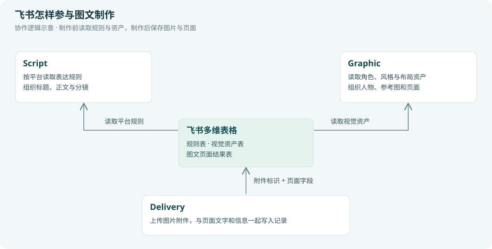

# 图文怎样生成，又怎样与飞书协作

最后的图文创作主线由Script、Graphic和Delivery三个工作流组成。它们分别处理内容、视觉与保存，飞书为这条链路提供规则和素材，也接收制作结果。

## 1. 从需求到每一页的画面说明

Script接收四类信息：本次具体选题、完整需求、已选痛点、医学目标卡。平台规则再补充发布场景中的表达要求。

它据此完成文案，检查后锁定标题和正文，再输出逐页分镜。分镜把“整篇内容”转成“这一页需要讲什么、画什么”。Graphic由此获得每页的文字、情境和视觉重点。

| 阶段 | 输入内容怎样变化 | 给后续带来的帮助 |
|---|---|---|
| 需求与目标 | 知道读者、问题、内容边界和表达要求 | 制作围绕同一个目标展开 |
| 文案 | 将依据整理成读者能理解的标题和正文 | 确定信息与文字 |
| 分镜 | 把文案分配到页面，并说明画面情境 | 让生图有明确的页面任务 |
| 页面生成包 | 把分镜、角色、风格、布局与参考图合并 | 每次生图得到相对完整的制作约束 |

## 2. 飞书在三个位置提供帮助

| 使用位置 | 飞书提供或接收什么 | 系统怎样使用 |
|---|---|---|
| Script制作前 | 平台表达规则 | 按用户选择的平台匹配规则，影响标题、正文与内容组织 |
| Graphic制作前 | 主角、科普角色、疾病形象、风格和布局模板 | 匹配本次分镜需要的角色、视觉参考与页面资源 |
| Delivery制作后 | 页面结果记录和图片附件 | 将本批图文组织为可查找、可协作的内容资料 |

规则和资产由表格管理后，团队可以持续积累可复用的人物、风格和版式。工作流读取这些配置，再把它们组合到本次主题中。

## 3. 不同风格怎样形成

风格首先是制作需求中的一项选择，例如3D卡通温馨、手绘水彩或写实插画。Graphic将它与分镜需求一起处理，形成可用于整套页面的视觉约束。

**已有风格资产：** 从风格库读取候选，匹配并锁定参考，将它纳入后续角色与页面制作。

**派生风格：** 根据本次要求编译风格设定，生成风格母版，检查后锁定，再从母版提炼系列风格语法。

两条路径最后汇合。页面任务共同继承风格参考与风格语法，使色彩、材质、人物表现和页面氛围围绕同一套设定展开。

| 风格方向 | 制作时需要明确的内容 | 可借鉴的使用方式 |
|---|---|---|
| 3D卡通温馨 | 圆润造型、材质、柔和色彩与光线等设定 | 家庭情境、人物陪伴、亲子内容 |
| 手绘水彩 | 笔触、纸感、配色和人物画法等设定 | 故事阅读、情境表达、柔和插画 |
| 写实插画 | 人物比例、场景细节和画面质感等设定 | 更贴近现实场景的图解与说明 |

表中展示风格配置思路；本说明中的实际候选样张为3D卡通方向。选定风格后仍会根据本次页面内容进行具体设计。

## 4. 多页图片怎样保持人物与表达一致

Graphic先从整套分镜识别持续角色、局部角色和场景。需要跨页出现的人物会形成统一的参考来源；已有合适角色时使用资产库，需要补充时先制作角色母版。

系统还会建立系列视觉事实库，将角色身份、风格和辅助资产放在一起。经常共同出现的人物可以生成组合锚点，让后续页面参考同一组人物关系。

| 一致性依据 | 记录或约束的内容 |
|---|---|
| 角色参考 | 同一个人物的身份、外观和辨识特征 |
| 风格参考 | 整套内容的色彩、材质和画面气质 |
| 组合锚点 | 需要反复同框的人物及相互关系 |
| 全局页面设计 | 各页的信息层次、布局节奏和视觉分工 |
| 锁定文字 | 页面中应当呈现的标题与正文 |

这些信息会进入逐页生成包。它为系列图文提供共同参考，也让后续检查有具体依据。

## 5. 每页怎样生成和检查

每页先生成两个候选，再检查文字与视觉表现。OCR用于读取候选中的文字，与本页应有文字对照；视觉检查关注人物、风格和画面组织。

需要调整时，系统编译有针对性的重试指令，再生成候选。结果按页保留，最终汇总候选图、检查意见和缺页等页面信息。

对内容团队来说，这一步提供了可继续选择与复核的素材。对系统设计来说，图片、文字和检查意见始终能对应到同一页。

## 6. 图片怎样真正进入飞书表格

Delivery同时拿到Script与Graphic结果，先把本次主题、受众版本、风格、比例以及逐页内容整理到一起。

工作流通过飞书插件读取表格，并在需要时取得应用访问凭证。保存时，图片按以下路径进入多维表格：

**已有图片地址 → 获取图片文件 → 上传为飞书图片附件 → 取得附件标识 → 与页面字段一起构造记录 → 批量写入多维表格。**

附件标识在技术上是`file_token`。多维表格图片列用它关联实际附件，用户便可以在记录中查看图片。

| 页面记录中的信息类别 | 用途 |
|---|---|
| 主题、批次、页码 | 查找同一篇内容及其全部页面 |
| 标题、正文和页面说明 | 保留图文中的内容信息 |
| 受众版本、风格和比例 | 理解这套内容的制作方式 |
| 候选或采用图片附件 | 查看、比较与使用图像素材 |
| 页面检查及保存结果 | 支持后续复核与内容管理 |

上表说明记录的组织思路，具体列名和枚举由实际飞书表配置决定。图片生成、页面检查和保存情况分别记录，用户可以清楚知道已经获得了哪些素材，以及它们怎样被整理。

## 7. 这条链路给团队留下什么

制作完成后，可分别使用文案、分镜、候选图片和页面记录：文案可以继续编辑，分镜可以交给设计人员，图片可以进入选用流程，飞书记录可以作为内容资料库的组成部分。

风格、角色和平台规则也能持续积累，供后续主题再次调用。新主题沿用生产结构，同时替换本次的问题、内容依据和场景需求。

[下一章：看看一套图文怎样组织](04-图文效果与应用案例.md)
