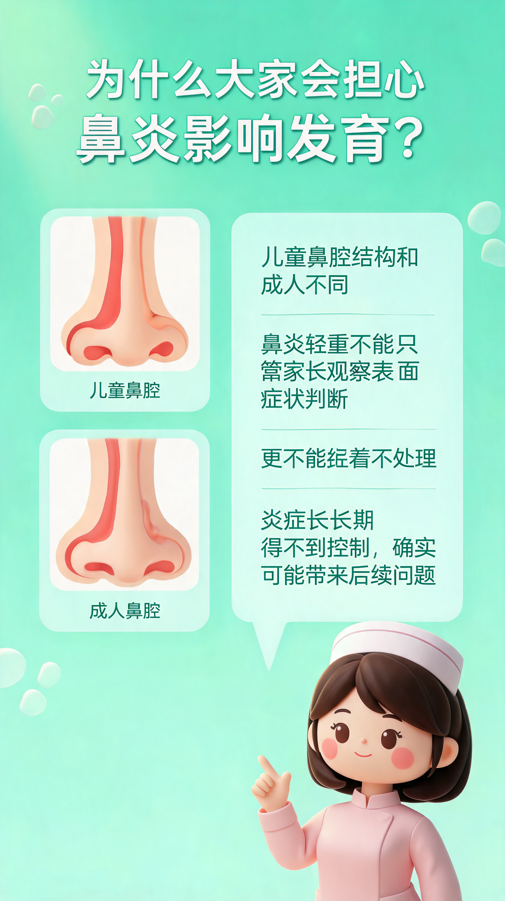
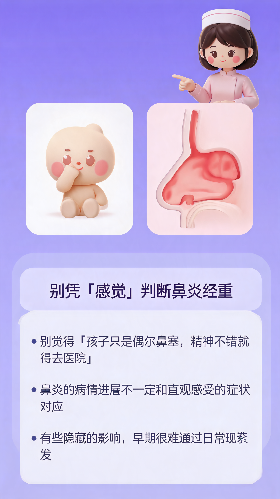
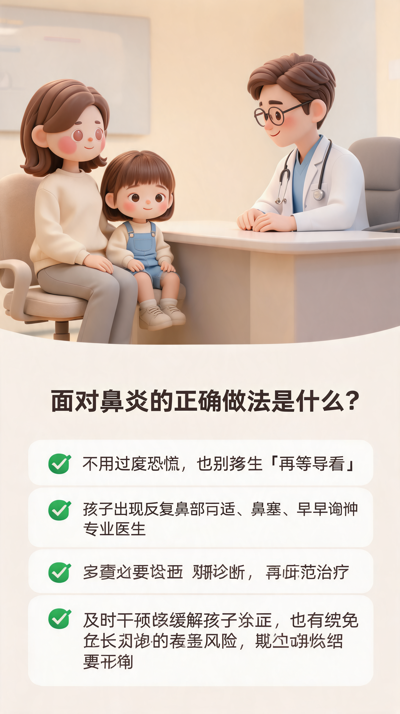
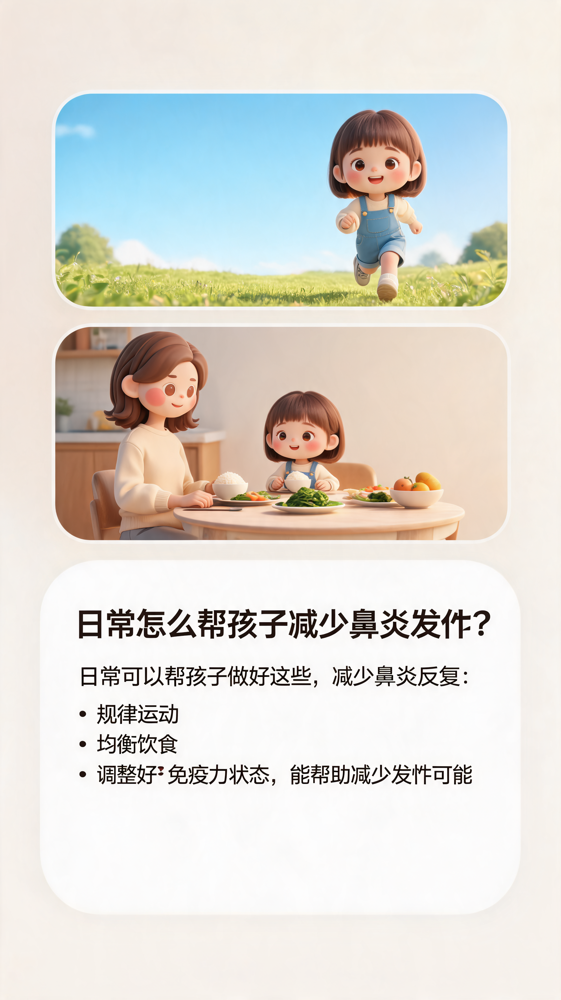

# 图文效果与应用案例

系统的产物包括内容准备、文案分镜和图像页面。把它们分开保存，可以让同一套内容以不同方式进入团队的制作流程。

## 1. 最后得到哪些内容

| 产物 | 可以怎样使用 |
|---|---|
| 已确认的需求 | 作为本次制作简报，后续修改有共同依据 |
| 候选选题与已选痛点 | 支持内容策划，保留本次切入点 |
| 医学目标与来源 | 为文案和人工复核提供内容范围 |
| 标题与正文 | 供编辑修改、平台适配或内容再利用 |
| 逐页分镜 | 供生图模块或人工设计制作页面 |
| 页面候选图 | 供选图、复核及后续修改 |
| 飞书页面记录 | 按主题、批次和页码组织团队内容 |

## 2. 六页候选图示例

以下六张取自2026-09-21系统一次真实六页生成，用于展示图文的页面结构与视觉表达。它们保留原始候选样张属性。

| 第1页：封面 | 第2页：读者困惑 | 第3页：知识解释 |
|---|---|---|
|  |  |  |
| 第4页：误区辨析 | 第5页：行动信息 | 第6页：生活场景 |
|  |  |  |

这批候选展示了标题、人物、家庭情境、科普角色、器官图示和分区文字的组合方式。样张用于观察制作形式，医学表述与文字采用前由内容团队复核。

## 3. 一套图文的阅读逻辑

以上页面可以从内容组织的角度理解：

| 页面作用 | 回答读者的哪类问题 | 制作上的表达方式 |
|---|---|---|
| 封面 | 这篇内容与我有什么关系？ | 大标题、核心人物和主题场景 |
| 读者困惑 | 它是不是在说我关心的事？ | 问题、对话气泡和生活感受 |
| 知识解释 | 我需要先理解什么？ | 简化图示、分区说明和科普角色 |
| 误区辨析 | 哪些直觉需要重新理解？ | 对照关系与重点信息 |
| 行动信息 | 阅读后应该关注什么？ | 分条信息与场景化表达 |
| 生活场景 | 这些信息怎样回到日常？ | 家庭或生活画面与收束内容 |

实际页数与顺序由分镜决定。这个案例展示了从“吸引注意”到“解释问题”、再到“回到场景”的组织方法，可以借鉴到其他知识图文中。

## 4. 同一个主题可以怎样变化

以“儿童鼻炎科普”为方向，可以从三个维度调整成品：

| 调整维度 | 示例 | 哪部分发生变化 |
|---|---|---|
| 具体切入点 | 从认识问题改为解释常见误区 | 研究重点、内容目标、文案和分镜 |
| 受众表达 | 从家长阅读改成亲子共读 | 语言、角色互动和页面形式 |
| 视觉方向 | 从3D卡通改成手绘水彩 | 风格参考、人物表现与页面画法 |

系统将这些要求分别管理，因此可以围绕同一内容方向讨论多种制作方案。具体成品仍需按相应参数重新制作。

## 5. 三种实际使用方式

**内容策划使用。** 先调用意图收集、痛点分析和医学研究，得到需求、选题与内容依据，再由编辑团队写作。

**设计团队使用。** 使用Script输出的文案与分镜，将其交给Graphic或人工设计，完成系列页面。

**内容运营使用。** 通过图文主线制作，再用Delivery把页面组织到飞书，便于查找、复核和选用。

三个角色可以使用同一条生产链的不同产物，减少重复解释本次主题、读者与制作要求。

[下一章：怎样独立使用和迁移这些模块](05-模块复用与拓展.md)
